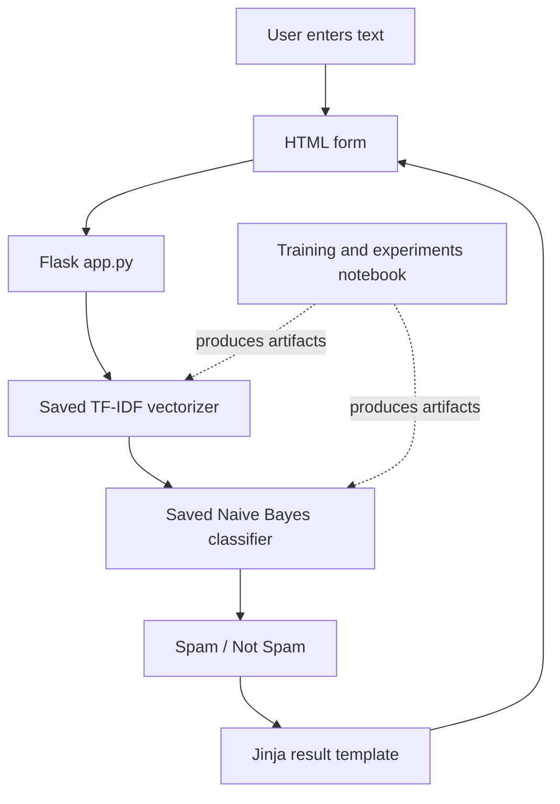

# Architecture

The project is a small server-rendered Flask application.

## Runtime files
- `app.py` defines the home and prediction routes.
- `templates/index.html` renders the input form and prediction.
- `static/style.css` styles the page.
- `vectorizer.pkl` and `spam_classifier_model.pkl` are loaded at application startup.

## Training boundary
The notebook contains experimentation and model-training work. The Flask runtime consumes pre-generated artifacts. Rebuild and validate both artifacts together whenever the preprocessing or feature vocabulary changes.
