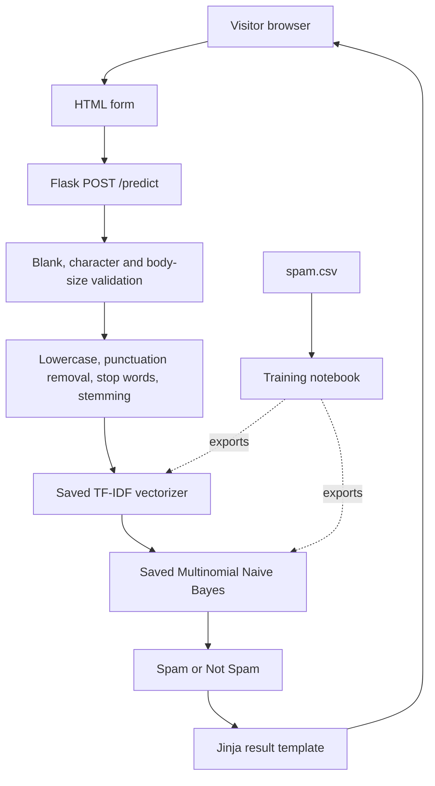

# Architecture

## Overview

The repository is a server-rendered Flask application. It accepts one plain-text message per request and performs synchronous inference using a saved Multinomial Naive Bayes classifier and its matching TF-IDF vectorizer.

## Runtime components

- `app.py`: artifact loading, Flask routes, input validation, preprocessing and inference.
- `templates/index.html`: message form, error state and prediction state.
- `static/style.css`: layout, form controls, feedback states and responsive styles.
- `spam_classifier_model.pkl`: fitted classifier artifact.
- `vectorizer.pkl`: fitted TF-IDF vocabulary and weighting artifact.
- `scripts/setup_nltk.py`: downloads and verifies the English stop-word corpus.
- `tests/test_app.py`: route and preprocessing behaviour tests.
- `tests/test_notebook.py`: syntax and source-contract tests for notebook cells.
- `Email_Spam_Detection_system_using_Naive_Bayes.ipynb`: training, evaluation and artifact export.

## Startup sequence

When `app.py` is imported, the model and vectorizer are loaded from paths relative to the application file. These deserialization operations happen at module import time. Missing, corrupt or incompatible artifacts can therefore prevent the application and test process from starting.

The NLTK stop-word wordlist is loaded lazily on the first preprocessing call and cached for subsequent requests.

## Request processing sequence

1. Browser sends `email_text` as a form field.
2. Flask enforces request-body limit.
3. Route rejects missing or whitespace-only input.
4. Route rejects messages longer than 10,000 characters.
5. Text normalization mirrors the notebook's transform sequence.
6. The fitted vectorizer creates a sparse feature representation.
7. The classifier predicts a numeric label.
8. The route maps the numeric label to a UI string and returns HTML.

## Training/serving contract

The fitted vectorizer and classifier must be built together from the same training pipeline. The input normalization at prediction time must match training normalization. Changing tokenization, punctuation handling, stop words, stemming or TF-IDF parameters requires rebuilding both artifacts.

## Trust boundaries

Submitted message text is untrusted input. Serialized model files are executable deserialization input. The application currently has no authentication, rate limiting, persistence, external API integration, or production monitoring. The text shown back to the user is rendered through Jinja autoescaping.

## Deployment shape

The built-in Flask server is intended for local development. Production deployment must use a WSGI server behind HTTPS termination and operational controls. See [DEPLOYMENT.md](DEPLOYMENT.md) and [OPERATIONS.md](OPERATIONS.md).
