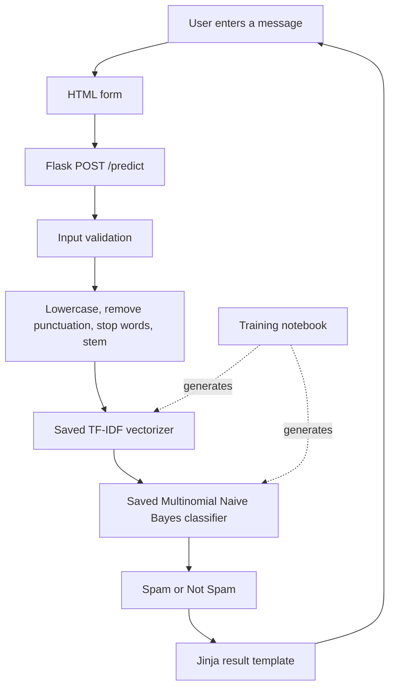

# Architecture

## Overview

The project is a server-rendered Flask application. It accepts one text message per request and performs synchronous inference with two trusted, pre-generated scikit-learn artifacts.

## Runtime components

- `app.py`: loads model artifacts, defines the Flask app, preprocesses input, validates requests, and renders results.
- `templates/index.html`: input and result views. Jinja auto-escaping is retained for submitted message content.
- `static/style.css`: responsive styling and visible focus/error states.
- `spam_classifier_model.pkl`: fitted Multinomial Naive Bayes classifier.
- `vectorizer.pkl`: fitted TF-IDF vocabulary and weighting state.
- `scripts/setup_nltk.py`: downloads and verifies the English stop-word corpus.
- `tests/test_app.py`: route and preprocessing tests.
- `Email_Spam_Detection_system_using_Naive_Bayes.ipynb`: data preparation, model training, evaluation, and artifact export.

## Training and serving contract

The notebook lowercases text, removes punctuation, removes NLTK English stop words, and applies Porter stemming before fitting the TF-IDF vectorizer. The Flask application must apply the same preprocessing before calling `vectorizer.transform()`. A mismatch changes the feature representation and can degrade predictions.

The classifier and vectorizer must be regenerated and deployed together. Do not update only one artifact.

## Request constraints

The application rejects blank input and messages longer than 10,000 characters. Flask also limits the total request body to 16 KiB. There is no database or persistent message store.

## Trust boundaries

- Submitted messages are untrusted input and must not be logged or stored casually.
- Pickle/joblib files are executable serialization formats. Only load artifacts built and reviewed in a trusted environment.
- A model result is an estimate, not a security verdict.
